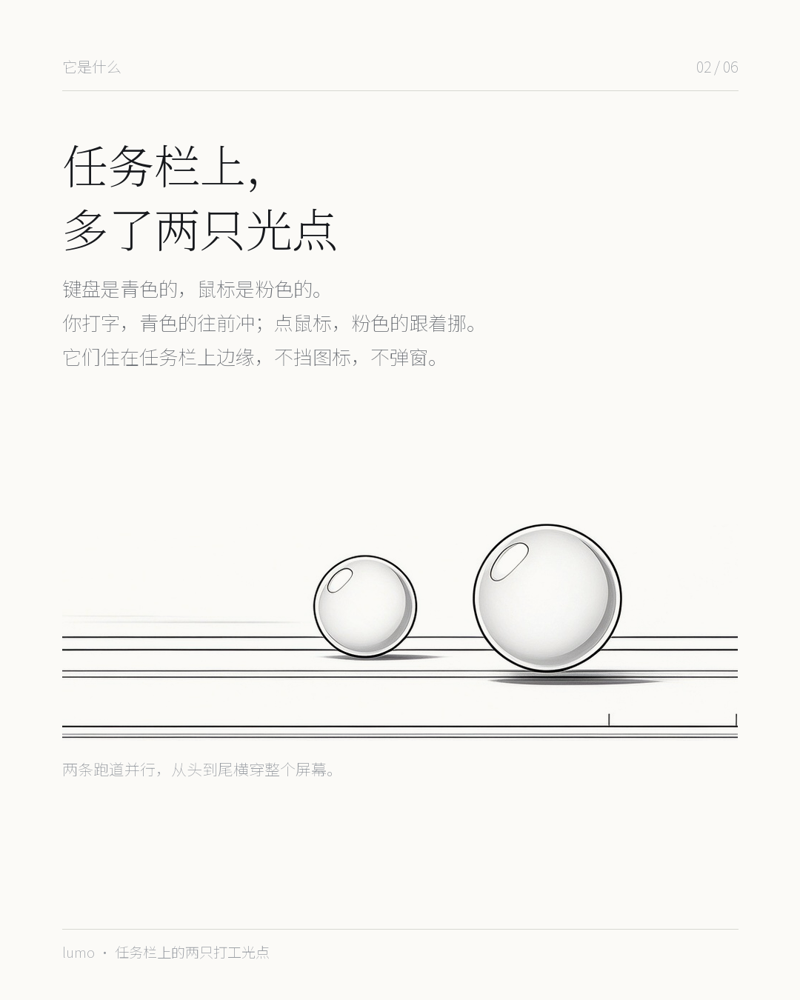
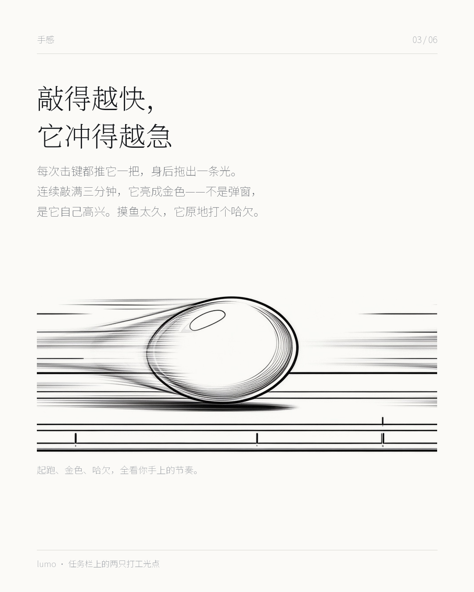
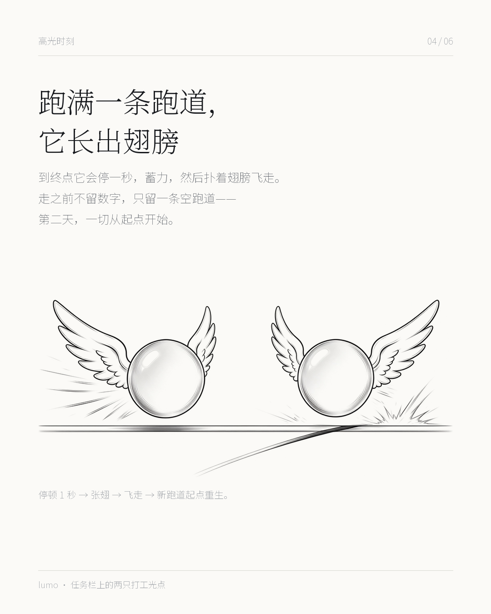

# 跑光 · lumo

> 你敲的每一下，都有人在跑。

一个贴在 Windows 任务栏上边缘的小玩具。键盘一颗青色的光点，鼠标一颗粉色的光点，各占一条细跑道。你打字，青的往前冲；你点鼠标，粉的跟着挪。跑满一条，它停一秒、长出翅膀、飞走，然后从新跑道的起点重新开始。


---

## 它是什么

不是效率工具，也不催你。它只是把你今天敲了多少下、点了多少次，用两颗光点跑一遍。

- **键盘青 · 鼠标粉**，贴在任务栏上边缘，不挡图标、不弹窗、鼠标穿透，点哪儿都不受影响
- **累计点击数**推进进度，**实时输入速度**决定身后的拖尾和冲劲（平滑跟随，不抖）
- **连敲满 3 分钟** → 亮成金色（不是弹窗，是它自己高兴）
- **闲置太久** → 原地打个哈欠
- **跑满一条跑道** → 停 1 秒 → 张翅 → 飞走 → 新跑道起点重生
- **醒来续旧跑道**：45 分钟没有输入算一次沉睡，醒来接着跑同一条，不清零
- **个人宇宙**：每飞走一颗，落成一顆星。一颗星 = 一天，点开是一张英雄卡片，它会按那天的节奏给个称号（夜航者 / 人形打字机 / 哈欠制造机……）
- **周五开箱**：每周五能开一次《本周工伤鉴定报告》，带段位和自嘲评语——摸鱼学徒，还是键盘战神，自己看
- **全参数可调**：跑道长度、平滑度、金色阈值、哈欠阈值、沉睡阈值、两种颜色、开机自启（默认关）

<table>
  <tr>
    <td></td>
    <td></td>
    <td></td>
  </tr>
</table>

---

## 视频

| 文件 | 内容 |
| --- | --- |
| [`media/concept-demo.mp4`](media/concept-demo.mp4) | 概念演示片（27 MB）：笔电里两颗光球在两条跑道上跑、涨速、张翅飞走 |

> 仓库里这个 MP4 就是开场动画那条片子。如果只想看图，`docs/cards-ink/` 里有六张竖版图文。

---

## 隐私

- 只**计数**：按了多少下键、点了多少次鼠标、滚了多少格。**不记录任何一个键、不读窗口标题、不截屏**
- 不联网、不登录、不上传。所有数据存在你自己机器的 `userData` 里（JSON，原子写入）
- 全局钩子用的是 [`uiohook-napi`](https://github.com/SnosMe/uiohook-napi)（N-API 预编译，不用装 VS 编译环境）

---

## 跑起来

环境：Windows 10 / 11，Node 20+

```bash
npm install
npm start
```

打包绿色版（免安装，解压双击）：

```bash
npx electron-builder --win dir
# 产物在 dist/win-unpacked/
```

> ⚠️ 如果启动后只有进程没有窗口，检查环境里是不是带了 `ELECTRON_RUN_AS_NODE=1`——那会让 Electron 退化成纯 Node。启动前 `unset ELECTRON_RUN_AS_NODE` 即可。

> ⚠️ NSIS 安装包在非管理员账户下可能打包失败（`winCodeSign.7z` 里有 macOS 符号链接，创建需要特权）。绿色版不受影响。

---

## 目录

```
lumo/
├── main.js              主进程：窗口几何、全局键鼠钩子、IPC、四个窗口、自启、持久化
├── preload.js           contextBridge 暴露的 IPC 接口
├── renderer/
│   ├── index.html       跑道窗口（透明、置顶、鼠标穿透）
│   ├── renderer.js      光点推进、拖尾、终点演出、会话切分、周报结算
│   ├── style.css        跑道与光点、翅膀动画
│   ├── settings.*       设置面板
│   ├── universe.*       个人宇宙（同心轨道 + 英雄卡片）
│   └── report.*         周五开箱 / 工伤鉴定报告
├── assets/              图标
├── docs/                图文卡片与文案
└── media/               演示视频
```

几个实现上的坑，写在这儿省得别人再踩：

- 透明置顶窗会被 DWM 剔出某些截屏路径（GDI 抓不到，得用 Desktop Duplication）
- `.core` 的飞行动画必须走 `@keyframes`——内联 `transform` 的优先级高于 class，动画会被覆盖掉
- 跟随用指数平滑 `1 - Math.exp(-dt / tau)`，比弹簧稳定，不会抖
- `app.setLoginItemSettings` 回读时必须带同样的 `path` / `args`，否则永远读回 false

---

## 还没做

- **竞赛制**：同一间办公室几个人一起跑，看谁先跑满（种子想法：先做「战绩卡导出」）
- macOS 适配（`uiohook-napi` 支持，但窗口层级和任务栏概念要重做）

---

## License

[MIT](LICENSE) © Jino
